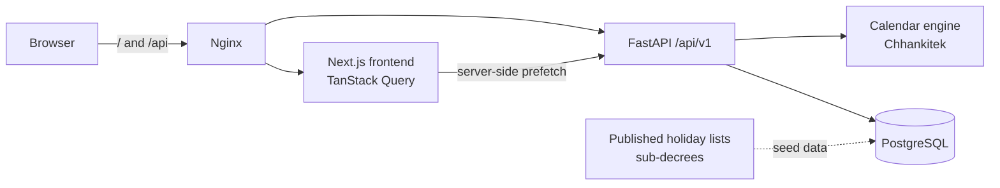

# Khmer Moon Calendar · ប្រតិទិនចន្ទគតិខ្មែរ

**Preserving Khmer Time and Tradition**

Khmer Moon Calendar shows Gregorian dates with the traditional Khmer lunar calendar (ចន្ទគតិ), Cambodian public holidays, Buddhist observances and festivals. Khmer is the default language. English is also available, and every date is interpreted in `Asia/Phnom_Penh`.

## Features

- Today's Gregorian and Khmer lunar date: lunar day, waxing/waning (កើត/រោច), month, Buddhist Era, animal year and Sak.
- Monthly calendar with keyboard navigation, today highlight, holidays, observances, full and new moons, and sila days.
- Year view with all 12 months and that year's public holidays.
- Gregorian → lunar and lunar → Gregorian conversion. Ambiguous or impossible lunar dates return explicit errors, such as using `asadh` in a leap-month year.
- Holiday directory with search, year and category filters, and a source and verification status for every record.
- Leap months (អធិកមាស, two Asadh months) and leap days (ចន្ទ្រាធិមាស, 30-day Jesth).
- **Verification labels**: each lunar date is `calculated`, `verified` (a published reference agrees) or `overridden` (a published reference disagrees and wins). Unverified calculations are never presented as official.
- Khmer and English UI with Khmer numerals and the Battambang font. Switching language keeps the current page and selection.
- Light and dark themes, responsive layout, and accessible markup.

## Architecture



See [docs/architecture/overview.md](docs/architecture/overview.md).

| Layer | Technology |
| --- | --- |
| Frontend | Next.js 16 (App Router), React 19, TypeScript (strict), Tailwind CSS 4, shadcn/ui-style components, TanStack Query, React Hook Form + Zod, next-intl |
| Backend | Python 3.13, FastAPI, Pydantic 2, SQLAlchemy 2.1, Alembic, pytest, Ruff, mypy (strict) |
| Data | PostgreSQL 17 (SQLite for zero-config local runs and unit tests) |
| Infrastructure | Docker, Docker Compose, Nginx, GitHub Actions |

## Repository layout

```text
KhmerMoonCalendar/
├── frontend/   Next.js app (own package.json and package-lock.json)
├── backend/    FastAPI app (own pyproject.toml and requirements*.txt lockfiles)
├── infra/      Production Dockerfiles, Nginx, database init and seeds, deployment compose
├── docs/       Architecture, API, database, calendar methodology, deployment, security
├── scripts/    setup/dev/lint/test helpers, seed_database.py
├── tests/      Playwright end-to-end tests and published-reference fixtures
└── .github/    CI and Docker build workflows
```

## Prerequisites

- Docker with Compose v2, **or**
- Python 3.13+, Node.js 22+, and Bash (Git Bash on Windows) for running without Docker.

## Quick start (Docker)

```bash
cp .env.example .env          # then set POSTGRES_PASSWORD
docker compose up --build     # or: make up
docker compose exec backend python -m app.db.seed   # load verified holidays and reference dates (or: make seed)
```

- Website: http://localhost:3000 (redirects to `/km`)
- API docs: http://localhost:8087/api/docs

The backend container applies migrations on start. PostgreSQL data persists in the `pgdata` volume.

## Local development (no Docker)

```bash
make setup    # venv + npm install + migrate + seed (SQLite by default)
make dev      # backend on :8087, frontend on :3000
```

To use PostgreSQL locally instead, set `DATABASE_URL=postgresql+psycopg://…` before `make setup`.

## Common commands

| Command | What it does |
| --- | --- |
| `make up` / `make down` | Start / stop the Docker dev stack |
| `make migrate` | `alembic upgrade head` in the backend container |
| `make seed` | Load verified seed data |
| `make test` / `npm run test` | Backend pytest + frontend Vitest |
| `make test-e2e` / `npm run test:e2e` | Playwright journey against a running stack |
| `make lint` / `npm run lint` | Ruff, mypy, ESLint, tsc |
| `npm run build` | Production frontend build |
| `make prod-up`, `make prod-migrate` | Production stack behind Nginx |

## Database migrations

```bash
cd backend
alembic upgrade head                                   # apply
alembic revision --autogenerate -m "describe change"   # create
```

## API

Interactive OpenAPI docs are at `/api/docs`. Examples are in [docs/api/openapi.md](docs/api/openapi.md).

```bash
curl "http://localhost:8087/api/v1/lunar-dates/convert?date=2026-10-11"
curl "http://localhost:8087/api/v1/lunar-dates/reverse?year=2570&month=assoch&day=1&phase=waning"
```

## Calendar accuracy

Read [docs/calendar/khmer-lunar-calendar.md](docs/calendar/khmer-lunar-calendar.md) before relying on dates. In short:

- The engine reproduces every lunar-anchored public holiday published for 2024–2026: Visak Bochea, Royal Ploughing, Pchum Ben and the Water Festival.
- Reference records currently come from **secondary** publications. Primary government texts still need review.
- The supported range is 1900–2100. Only 2024–2027 are listed in the sitemap.

## Deployment

See [docs/deployment/production.md](docs/deployment/production.md) for Docker/Nginx, or [docs/deployment/cloud.md](docs/deployment/cloud.md) for Vercel + Render + Neon.

## License

MIT; see [LICENSE](LICENSE) and [THIRD_PARTY_NOTICES.md](THIRD_PARTY_NOTICES.md).
