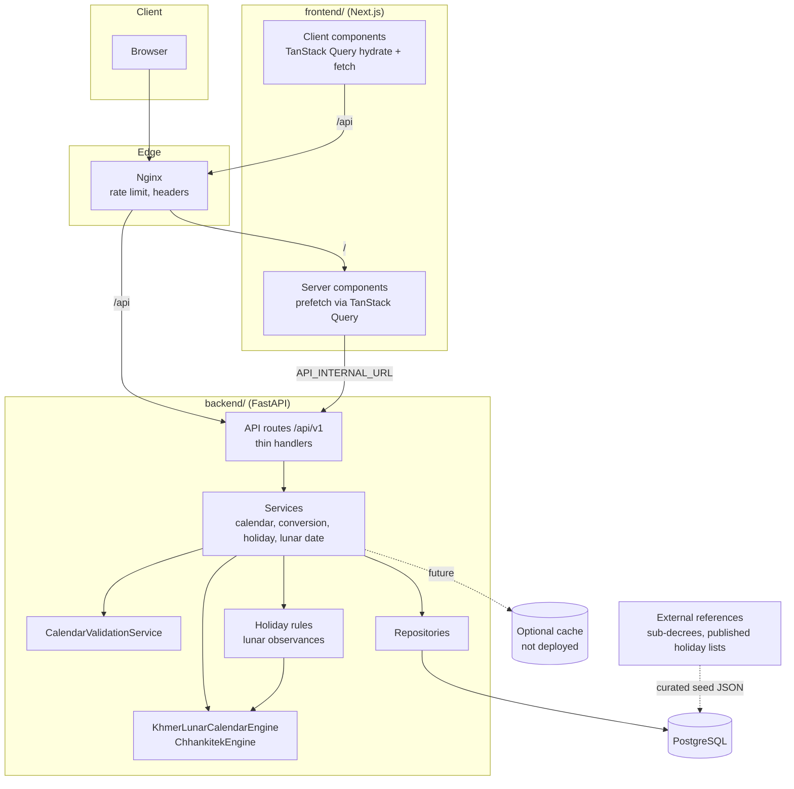

# Architecture overview

## Layers

| Layer | Location | Responsibility |
| --- | --- | --- |
| Domain: calculation | `backend/app/domain/calendar/chhankitek.py` | Pure Chhankitek arithmetic. No I/O. |
| Domain: engine boundary | `backend/app/domain/calendar/engine.py` | `GregorianToKhmerLunarConverter`, `KhmerLunarToGregorianConverter`, `KhmerLunarCalendarEngine` protocols, plus `ChhankitekEngine`. |
| Domain: formatting | `backend/app/domain/calendar/formatting.py` | Khmer and English strings, Khmer numerals. |
| Domain: validation | `backend/app/domain/calendar/validation.py` | Reconciles calculations with published `LunarDateRecord`s. |
| Domain: observances | `backend/app/domain/holidays/rules.py` | Traditional lunar rules (Visak, Meak, Pchum Ben…). Always `calculated`. |
| Services | `backend/app/services/` | Use cases that combine domain and repositories. |
| API | `backend/app/api/v1/endpoints/` | Input validation and response models only. |
| Persistence | `backend/app/models`, `backend/app/db` | SQLAlchemy models, repositories, seed loader, Alembic. |
| Frontend | `frontend/src` | Pages in `app/[locale]`, data via `lib/api/query-options.ts`, UI in `components/` and `features/`. |

## Data flow for a month view

1. The browser requests `/km/calendar/2026/10`.
2. The Next.js server component prefetches `monthQuery(2026, 10)` with TanStack Query (`API_INTERNAL_URL`), then dehydrates it.
3. `MonthCalendar` (client) hydrates the query. Month navigation then fetches `/api/v1/calendar/month` directly from the browser (same origin, through Nginx or the Next.js dev rewrite).
4. FastAPI's `CalendarService.month` asks `LunarDateService` for each day. That service uses the engine, then `CalendarValidationService` against stored reference records. Holidays come from the database, and observances from lunar rules.

## Architectural decisions

- [ADR 0001 – Port MomentKH's Chhankitek algorithm to Python](decisions/0001-calendar-engine.md)
- [ADR 0002 – Separate calculated dates, references and official holidays](decisions/0002-data-provenance.md)
- [ADR 0003 – Single FastAPI service with PostgreSQL; no Redis yet](decisions/0003-no-redis.md)
- [ADR 0004 – TanStack Query for all frontend data fetching](decisions/0004-tanstack-query.md)
