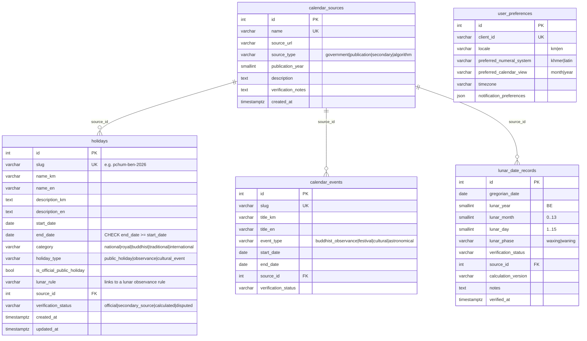

# Database schema

PostgreSQL 17, managed with Alembic (`backend/migrations`). Enums are stored as `VARCHAR` with `CHECK` constraints, which keeps them portable to SQLite for tests. Timestamps are `timestamptz`. The database timezone is set to `Asia/Phnom_Penh` (`infra/database/init`). Calendar dates are plain `date` values in Cambodian civil time.

## Indexes and constraints

| Table | Index / constraint | Purpose |
| --- | --- | --- |
| holidays | `ix_holidays_start_end (start_date, end_date)` | Year and month range queries |
| holidays | `ix_holidays_category`, `ix_holidays_name_en`, `uq_holidays_slug` | Filters, search, detail lookup |
| calendar_events | `ix_calendar_events_start_end`, `ix_calendar_events_event_type` | Range queries, filters |
| lunar_date_records | `ix_lunar_date_records_gregorian_date` | Per-day reference lookup |
| lunar_date_records | `ix_lunar_date_records_lookup (lunar_year, lunar_month, lunar_day, lunar_phase)` | Reverse lookups |
| lunar_date_records | `UNIQUE (gregorian_date, source_id)` | One record per source per day |
| all FKs | `ON DELETE RESTRICT` | Sources can't be removed while referenced |

## Design notes

- **Calculated lunar dates are not stored.** `lunar_date_records` only holds dates published by a source (see [ADR 0002](../architecture/decisions/0002-data-provenance.md)).
- `user_preferences` exists for future use. No authentication is implemented, and no endpoint writes it yet.
- Seed data lives in `infra/database/seeds/verified` (sourced). Load it with `python -m app.db.seed`, which is idempotent.
