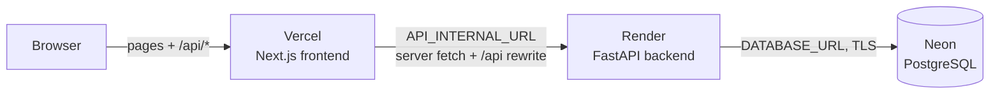

# Cloud deployment: Vercel + Render + Neon

The browser only talks to Vercel. Server components call the backend directly, and the browser's same-origin
`/api/*` requests are proxied by the rewrite in `frontend/next.config.ts`. Pick the same region everywhere
(Singapore: Neon `aws-ap-southeast-1`, Render `singapore`, Vercel `sin1`).

## 1. Neon (database)

1. Create a project in region **AWS Asia Pacific (Singapore)**. The default database is `neondb`.
2. On the dashboard choose **Connect** and turn **Connection pooling off** to get the *direct* string
   (host `ep-…​.aws.neon.tech`, no `-pooler`). It looks like
   `postgresql://<user>:<password>@ep-<id>.ap-southeast-1.aws.neon.tech/neondb?sslmode=require&channel_binding=require`.
   - Paste it as is: the backend switches `postgresql://` to the psycopg 3 driver itself.
   - Use the direct string: the backend keeps its own small pool and sets a 5-second statement timeout
     at connect time, which Neon's pooler endpoint does not accept. If you do use the `-pooler` string,
     the backend skips that setting; set it on the role instead:
     `ALTER ROLE <user> SET statement_timeout = '5s';`
3. Nothing else is needed: the backend creates the schema (Alembic) and loads the verified seed data on start.

## 2. Render (backend)

1. Push the repository to GitHub/GitLab.
2. Render → **New → Blueprint** → select the repository. Render reads `render.yaml` and creates
   `khmer-moon-calendar-api` (Docker, the root `Dockerfile`).
   Creating a plain **Web Service** instead also works: choose runtime **Docker** and leave Root Directory,
   Dockerfile Path and Docker Command at their defaults; Render then builds `./Dockerfile`.
3. Enter the two secret variables when prompted:

   | Key | Value |
   | --- | --- |
   | `DATABASE_URL` | the Neon direct connection string from step 1 |
   | `CORS_ORIGINS` | your Vercel URL, e.g. `https://khmer-moon-calendar.vercel.app` (comma-separate several) |

4. Deploy. On every start the container (root `Dockerfile`) runs `alembic upgrade head`, then `python -m app.db.seed`
   (both idempotent), then uvicorn on Render's `$PORT`.
5. Check `https://<service>.onrender.com/api/v1/health`: it should return `"database":"ok"`.

Free instances sleep after 15 minutes without traffic and take roughly 30–60 seconds to wake. The frontend
gives each API request 10 seconds, so the first visit after a sleep can show the "could not be loaded / Try
again" state. Use the **Starter** plan (`plan: starter` in `render.yaml`) to avoid this.

## 3. Vercel (frontend)

1. Vercel → **Add New → Project** → import the repository.
2. **Root Directory: `frontend`**. Framework is detected as Next.js; keep the default build settings.
   `frontend/vercel.json` pins serverless functions to `sin1`.
3. Environment variables (Production, and Preview if you use previews):

   | Key | Value |
   | --- | --- |
   | `API_INTERNAL_URL` | `https://<service>.onrender.com` (no trailing slash, no `/api`) |
   | `NEXT_PUBLIC_SITE_URL` | `https://<your-app>.vercel.app` (or your custom domain), used for metadata and the sitemap |

4. Deploy, then open `https://<your-app>.vercel.app/km`.
5. If you add a custom domain, update `NEXT_PUBLIC_SITE_URL` on Vercel and `CORS_ORIGINS` on Render, then redeploy both.

`API_INTERNAL_URL` is read at build time for the `/api` rewrite, so redeploy the frontend after changing it.

## Checklist

- [ ] Neon direct connection string saved only in Render (never committed; `.env` stays local).
- [ ] Render health check returns `"database":"ok"`.
- [ ] `https://<your-app>.vercel.app/api/v1/health` also returns OK (proves the Vercel → Render rewrite).
- [ ] The calendar shows holidays for 2026 (seed data loaded).
